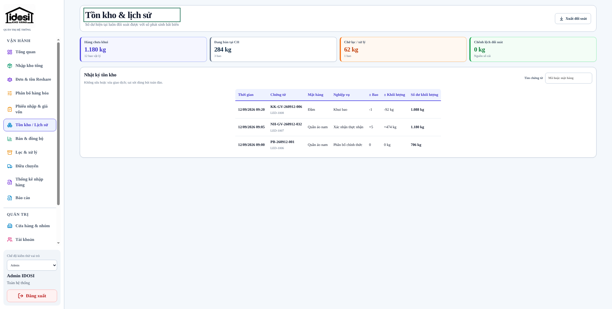
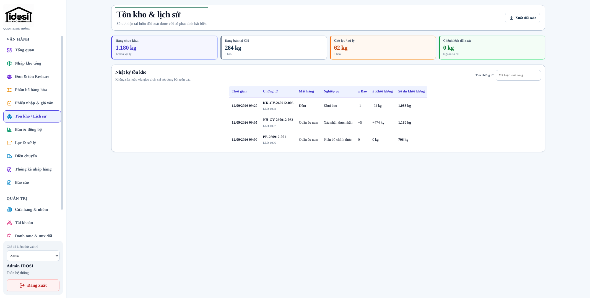
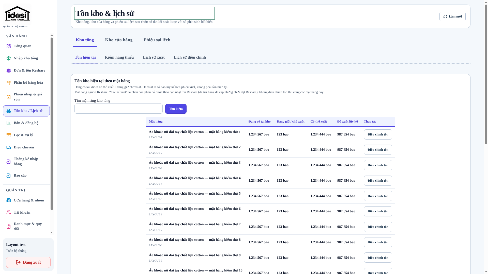
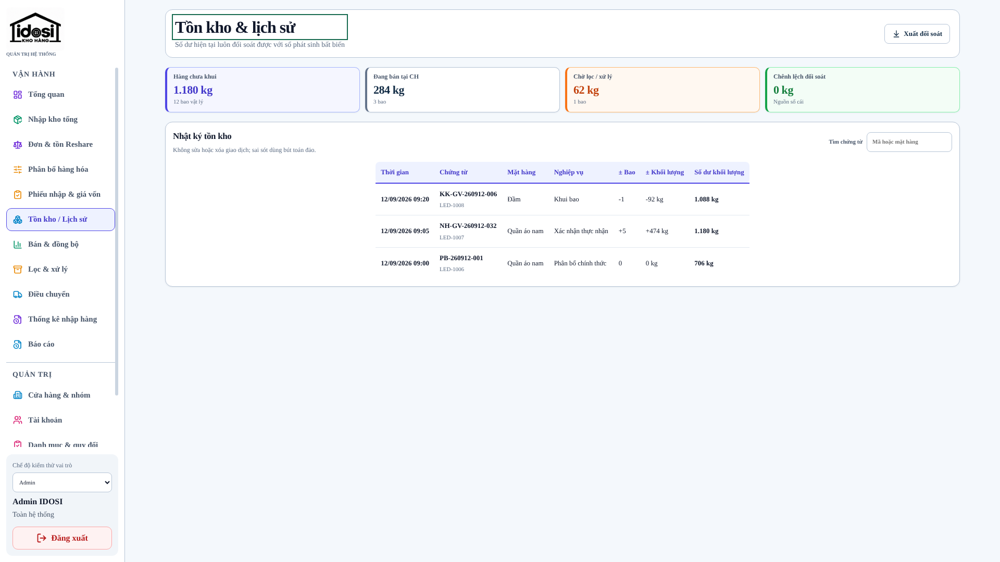
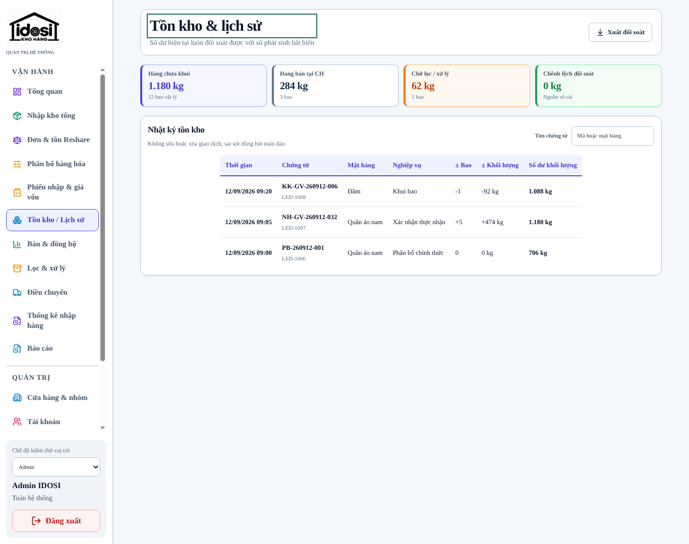
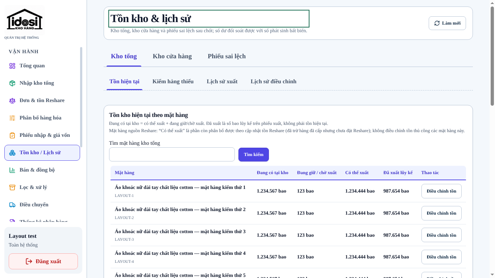
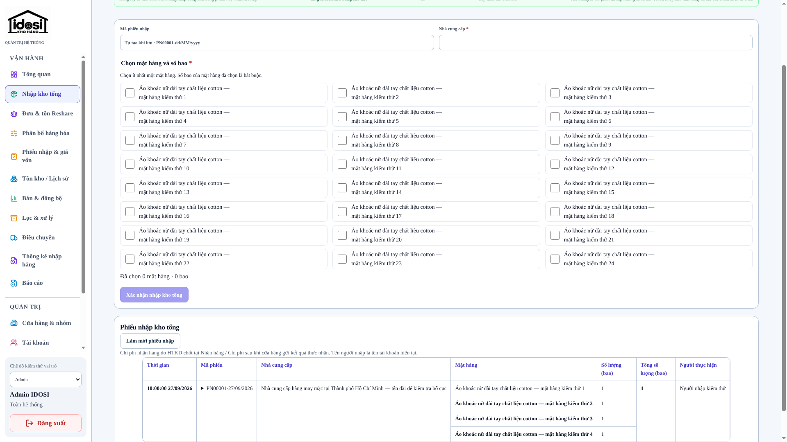
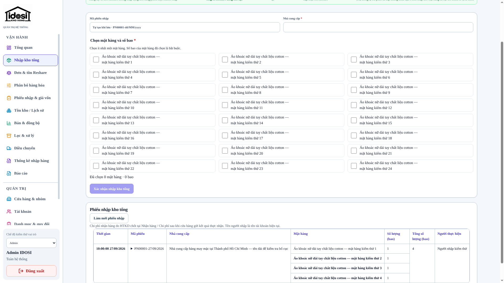
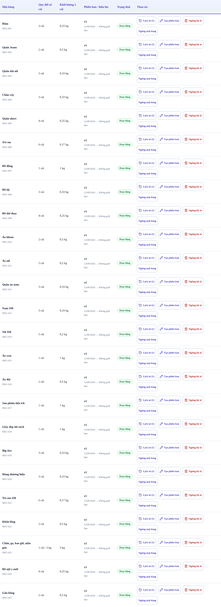
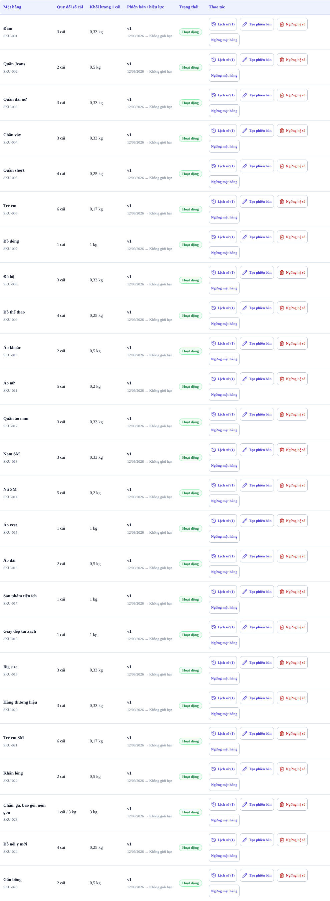

# Desktop: lề rộng gấp 3 và thanh cuộn danh mục mảnh

Phạm vi: chỉ CSS giao diện web (`apps/web/src/styles.css`) và hợp đồng kiểm thử bố cục. Không đổi
API, quyền, dữ liệu, tính toán kho, migration hay deploy. Áp dụng chung cho mọi vai trò vì cả
hệ thống dùng một khung `.app-main` và một sidebar.

## Yêu cầu → kết quả

| #   | Yêu cầu                                         | Trước                                                   | Sau                                                                                         |
| --- | ----------------------------------------------- | ------------------------------------------------------- | ------------------------------------------------------------------------------------------- |
| 1   | Lề trái/phải vùng làm việc gấp 3 lần hiện tại   | 54px mỗi bên                                            | 162px (3×) từ 2090px; không đủ chỗ thì 108px (2×); hẹp hơn nữa lề vừa đủ để bảng không chật |
| 2   | Bảng không xuống dòng, không tràn, không che    | —                                                       | audit 450 route × vai trò × độ rộng: không ô nào xuống dòng thêm, không cuộn/tràn mới       |
| 3   | Thanh cuộn danh mục chính mảnh lại              | thanh cuộn cổ điển 15–17px có nút mũi tên (Chrome/Edge) | 6px, bo tròn, không nút mũi tên; Firefox `scrollbar-width: thin`                            |
| 4   | Hộp danh mục chính lớn hơn một chút             | sidebar 224px, nhãn dài xuống 2 dòng                    | sidebar 240px; "Phiếu nhập & giá vốn", "Thống kê nhập hàng" nằm một dòng                    |
| 6   | Không cuộn ngang; bảng lớn thì xuống dòng       | bảng rộng cuộn ngang cục bộ                             | bảng xuống dòng; ≤1100px bảng lớn thành thẻ có nhãn — xem responsive-table-layout-audit.md  |
| 5   | Mã chứng từ không bị ngắt (phát hiện khi audit) | `PN00001-27/09/2026` có thể gãy làm 2 dòng              | `summary` trong lịch sử chứng từ `white-space: nowrap` như `time`                           |

## Thiết kế lề

Nguyên tắc: bảng không xuống dòng thêm, không tràn. Lề chọn theo bậc:

1. **Gấp 3** lề cũ (162px) khi vùng làm việc vẫn còn đủ 1526px — từ 2090px
   (`@media (min-width: 2090px)`; 2090 = sidebar 240 + 1526 + 2 × 162).
2. Không đủ thì tối đa **gấp 2** (108px), chỉ khi bảng vẫn vừa — từ 1982px.
3. Hẹp hơn: lề lớn nhất mà bảng vẫn vừa, `min((100vw − sidebar − 1526px) / 2, 108px)`, không
   nhỏ hơn lề nền `clamp(18px, 10px + (100vw − 821px) × 0.0785, 46px)` = lề cũ trừ 8px (nửa phần
   sidebar rộng thêm), nên tới 1858px vùng làm việc đúng bằng bản trước.

1526px là bề rộng tự nhiên (không xuống dòng) của bảng rộng nhất — lịch sử nhập kho tổng — cộng
viền panel và 15px thanh cuộn dọc cổ điển của Windows (nằm trong `100vw`), đo trên mọi route × vai trò.

Phương án đã loại (đều đo bằng audit bên dưới):

- Lề 162px từ 1280–1600px: vùng làm việc 1366/1440px còn 716–935px, tên mặt hàng trong bảng tồn
  kho xuống dòng (hàng 83–105px thay vì 61px).
- `--workspace-min` 1034/1108px: bảng danh mục (cần 1073px) xuống dòng 28 ô ở 1440px; lịch sử nhập
  kho tổng ở 1920px xuống dòng 9 ô thay vì 3, lưới chọn mặt hàng từ 3 cột còn 2.

| Viewport | Lề mỗi bên trước → sau | Vùng làm việc trước → sau |
| -------- | ---------------------- | ------------------------- |
| 1366     | 54 → 46px              | 1034 → 1034px             |
| 1440     | 54 → 46px              | 1108 → 1108px             |
| 1920     | 54 → 77px              | 1588 → 1526px             |
| 2000     | 54 → 108px (2×)        | 1668 → 1544px             |
| 2133     | 54 → 162px (3×)        | 1801 → 1569px             |
| 2560     | 54 → 162px             | 2228 → 1996px             |
| ≤820     | 16/18px (mobile)       | không đổi                 |

## Audit bảng (trước/sau)

Bản dựng mock, thanh cuộn thật, 4 vai trò (Admin, HTKD, cửa hàng lẻ, quầy sỉ) × mọi route được
phép × 1366/1440/1680/1920/1980/2050/2070/2150/2560px = 450 tổ hợp, 6.768 ô bảng. Đếm ô có một đoạn chữ nằm trên
hơn một dòng, bảng phải cuộn ngang và trang tràn ngang.

- Kết quả: **0 tổ hợp xấu hơn bản trước**; không bảng nào phải cuộn ngang; không trang nào tràn.
- Hai trường hợp xuống dòng có từ trước (danh mục 1366px, tiêu đề cột số lịch sử nhập kho tổng)
  đã sửa — xem "Bảng không bị ép nhỏ". Lần chạy cuối (19 độ rộng 360–2560px, 950 tổ hợp): 0 cuộn
  ngang, 0 tràn, 0 ô xuống dòng thêm so với bản trước.

## Bảng không bị ép nhỏ

Yêu cầu: "mở rộng bảng ra, đừng ép nhỏ bảng". Bảng dùng đủ bề ngang; cột ngắn không bị bóp để
chữ phải xuống dòng, chỉ cột chữ dài (tên mặt hàng, nhà cung cấp) xuống dòng khi thiếu chỗ.

- Danh mục (từ 1101px): bảng rộng 100% vùng chứa; tiêu đề, số quy đổi, khối lượng, phiên bản /
  hiệu lực và trạng thái một dòng; nhóm nút thao tác xuống hàng khi hết chỗ. 1366px: chỉ còn tên
  "Chăn, ga, bao gối, nệm gòn" xuống dòng (trước: 28 ô).
- Lịch sử nhập kho tổng: bỏ cột số cố định 6rem; "Số lượng (bao)", "Tổng số lượng (bao)" một
  dòng ở mọi độ rộng bảng; từ 1366px mọi tiêu đề một dòng; từ 1920px cả bảng không ô nào xuống
  dòng.
- `desktop-table-density`: cột số tối đa 150px (bằng tiêu đề một dòng), thay cho 110px cũ.

## Thanh cuộn

Chromium/Safari dùng `::-webkit-scrollbar` (6px). Không đặt `scrollbar-width` cho Chromium vì từ
Chrome 121 thuộc tính chuẩn vô hiệu hóa `::-webkit-scrollbar`; Firefox nhận `scrollbar-width: thin`
qua `@supports not selector(::-webkit-scrollbar)`. Áp dụng cho `.sidebar__nav` và `.sidebar`.

## Bằng chứng

Ảnh chụp có thanh cuộn thật (bỏ cờ `--hide-scrollbars` của Playwright):

| Màn hình             | Trước                                                                     | Sau                                                                    |
| -------------------- | ------------------------------------------------------------------------- | ---------------------------------------------------------------------- |
| Tồn kho 2133px       |          |          |
| Tồn kho 1920px       |          |          |
| Tồn kho 1366px       |          |          |
| Nhập kho tổng 1920px |  |  |
| Danh mục 1366px      |            |            |

Kiểm thử: `desktop-gutter.ts` là nguồn duy nhất của công thức lề cho `desktop-layout`,
`desktop-login-shell` và `desktop-visual-colors` (ma trận mọi route × 4 vai trò ở
1366/1440/1920/2560px). `desktop-table-density` giữ hàng bảng tồn kho ≤ 65px từ 1366px. Test mới
trong `desktop-login-shell.spec.ts` bật thanh cuộn thật, khẳng định thanh cuộn danh mục ≤ 6px và
sidebar 240px.

Rollback: revert commit; không có migration hay dữ liệu cần hoàn tác.
